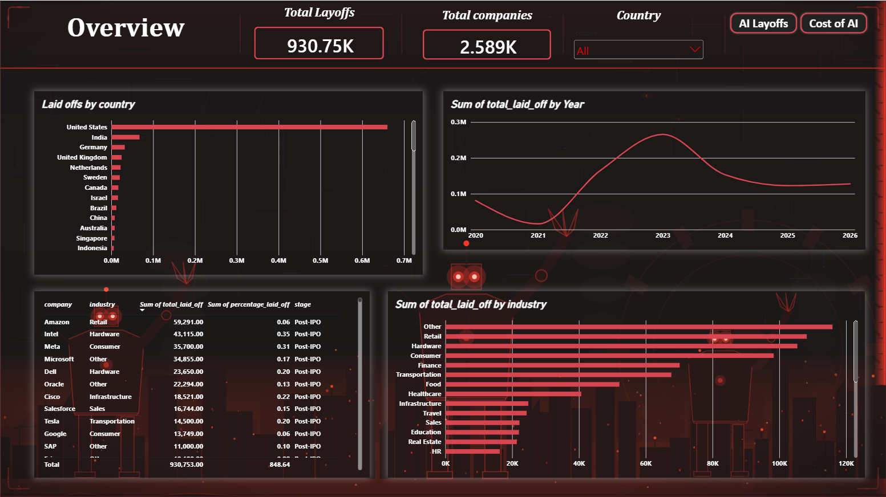
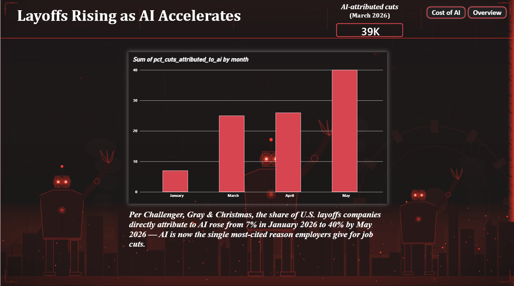
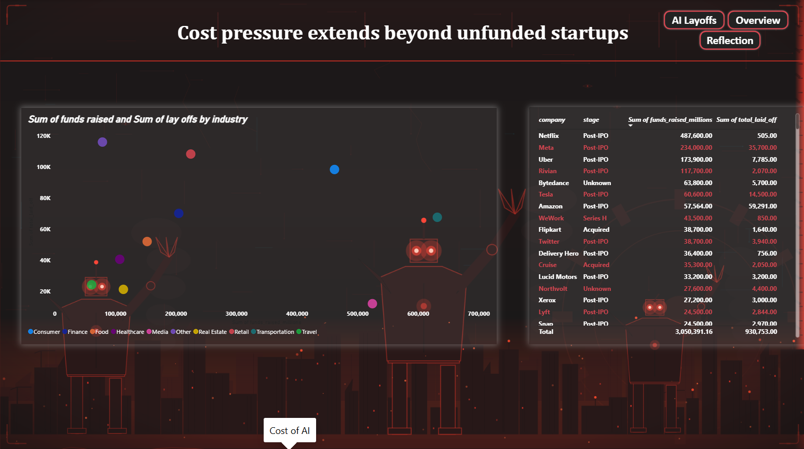

# AI & Tech Layoffs: SQL Server + Power BI

Who blames AI for job cuts, and who keeps cutting anyway? This project cleans a tech layoffs dataset in SQL Server (T-SQL), adds a second dataset that records the reasons employers give, and presents both sides of the story in a 4-page Power BI dashboard.

**Tools:** SQL Server · T-SQL · SSMS · Power BI (DAX, data modeling)

## Key finding

In 2026, the share of US job cuts that employers attributed to AI rose from **7% in January to 40% in May**, with 25% in March and 26% in April. The layoffs dataset has no cause column, so it can show where and when cuts happened, but not why. The second dataset fills that gap.

## Datasets

| Dataset | What it contains | Coverage |
|---|---|---|
| Tech layoffs (Kaggle) | 4,581 raw records: company, location, industry, stage, country, funds raised, layoff count and percentage | 2020-03-11 to 2026-08-27 |
| AI-attributed layoffs (Challenger, Gray & Christmas) | Monthly US job cuts and the share attributed to AI | Jan to May 2026, plus 2025 full-year and year-to-date totals |

Kaggle source: [https://www.kaggle.com/datasets/swaptr/layoffs-2022]

The second dataset was compiled by hand into `ai_attributed_layoffs.csv` from Challenger, Gray & Christmas's published monthly reports. February 2026 has no figures, so it is left blank.

## What I did in SQL

The full script is in [`sql/01_cleaning.sql`](sql/01_cleaning.sql). Raw data was imported into a `layoffs_staging` table with the SSMS Import Flat File wizard.

1. **Fixed types:** `funds_raised` was stored as text (like `$1,200`). I stripped the symbols with `REPLACE` and converted it to a numeric column with `TRY_CAST`.
2. **Standardized text:** trimmed whitespace with `LTRIM`/`RTRIM` and converted blank strings to `NULL`.
3. **Removed duplicates:** used `ROW_NUMBER() OVER (PARTITION BY ...)` in a CTE and deleted every row after the first in each group of identical records.
4. **Removed unusable rows:** dropped rows with neither a headcount nor a percentage, since the layoff size cannot be measured.
5. **Validated:** compared row counts, checked `DISTINCT` industry and country values, counted missing values per column and confirmed the date range.

**Result: 4,581 raw rows cleaned down to 3,837.**

## Dashboard

Four pages, built to be read in order:

| Page | What it shows |
|---|---|
| 1 | Overall layoffs from 2020 to 2026: totals, trend over time and the biggest sectors |
| 2 | **Layoffs Rising as AI Accelerates:** the AI-attributed share of US job cuts, January to May 2026 |
| 3 | **Cost pressure extends beyond unfunded startups:** funds raised vs. layoffs by industry, plus a company-level table |
| 4 | Both sides of the story, ending with an open question for the viewer |

The full file is [`dashboard/Dashboard.pbix`](dashboard/Dashboard.pbix) (open it with Power BI Desktop).

### Page 1


### Page 2


### Page 3


### Page 4


## Limitations

- The two datasets do not start at the same date: the layoffs data starts in 2020 and the AI-attributed data covers 2026 only, so I compare trends and do not merge them row by row.
- Challenger's figures cover **US job cuts only** and rely on **employers' stated reasons**. A company that blames AI is not proof that AI caused the cut, and the dashboard presents this as correlation, not causation.
- Funding values contain extreme outliers in the source data, which stretches some axes. I kept them as they are and did not alter the source.

## Repository structure

```
├── README.md
├── sql/
│   └── 01_cleaning.sql
├── data/
│   ├── layoffs_cleaned.csv
│   └── ai_attributed_layoffs.csv
└── dashboard/
    ├── Dashboard.pbix
    └── page1.png ... page4.png
```

To reproduce: download the raw Kaggle CSV, import it into SQL Server as `layoffs_staging`, run `sql/01_cleaning.sql`, then point the Power BI file at your database.

## Author

Ahmed Farghali · [LinkedIn](https://www.linkedin.com/in/ahmdfarghali)
